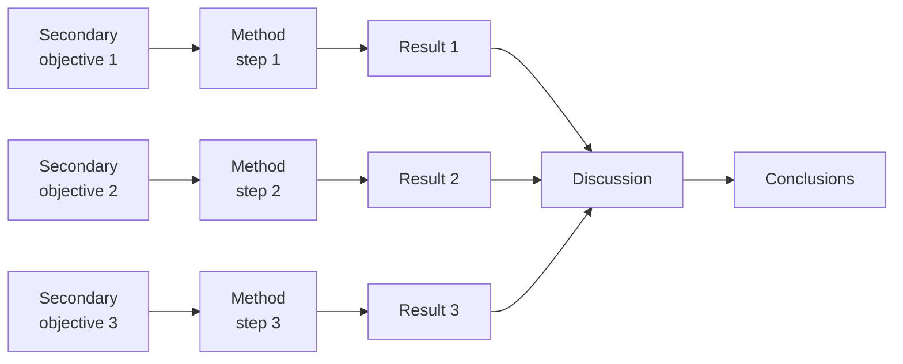

# Thesis structure

There's one structure that works for almost any final project, whether it's about development, experiments or a review. It's the same one scientific papers use, and it has a huge advantage: **each chapter answers one question**, so readers know where to find everything.

## The universal structure

| Chapter | Question it answers |
|---|---|
| 1. **Introduction** | What is the problem and why does it matter? |
| 2. **Related work** | What has already been done and what's missing? |
| 3. **Objectives** | What exactly am I going to do? |
| 4. **Materials and methods** | What did I use and how did I do it? |
| 5. **Results** | What did I get? |
| 6. **Discussion** | What do my results mean compared with what was already known? |
| 7. **Conclusions** | Did I meet my objectives? What's left to do? |
| **References** | What did I build on? |

Before the chapters come the **cover page**, the **abstract** (and *resumen*, if your university requires both) with keywords, and the **tables of contents**. At the end, **appendices** if you need them. Your university may require extra chapters (for example impact, budget, or ethical and legal aspects). Add them, but keep this skeleton.

## The common thread

!!! clave "One result for each step of the method"
    To keep the thesis easy to write and to read, each **secondary objective** becomes a **step in your method**, which produces **one result**, which is **discussed** and leads to **one conclusion**.

An example:

| Secondary objective | Method step | Result |
|---|---|---|
| SO1. Select and prepare a public ECG dataset | 4.1 Data selection and preprocessing | 5.1 Description of the final dataset (number of records, classes, quality) |
| SO2. Train two classification models | 4.2 Model design and training | 5.2 Learning curves and final configuration |
| SO3. Compare their performance | 4.3 Evaluation protocol and metrics | 5.3 Comparison table of metrics with confidence intervals |

If, at the end, a result doesn't correspond to any objective, or an objective has no result, there's a coherence problem. Use this table as a check.

## Chapter by chapter

### Abstract

Write it **last**. 250–300 words (or whatever your university asks for), structured as: background (1–2 sentences), objective, methods, main results **with figures**, and conclusion. Add 4–6 keywords. Many people will read only this.

### 1. Introduction

Move from general to specific: the **context**, the specific **problem** and the **motivation** (why it's worth solving, with data and citations). It can end with a paragraph explaining how the document is organised. Write it last, when you know what you've said.

### 2. Related work

The literature review, done with a method (see [Literature review](estado-del-arte.md)). Organised by themes, with a comparison table, and ending with **the gap your project will fill**.

### 3. Objectives { #objectives }

- **Main (primary) objective:** one, in one sentence, with a verb you can check.
- **Secondary objectives:** 2–4 that together achieve the main one. Each will be a step in the method.

If your project has a **research question** or **hypothesis**, it goes here too. Some universities prefer the objectives inside the introduction: follow your regulations.

### 4. Materials and methods

- **Materials:** your tools (data, participants, software, hardware, instruments).
- **Methods:** the steps you took, in order, and **based on which methodology**.

Everything needed for someone else to repeat it. More in [Methodology and development](metodologia.md).

### 5. Results

- **One section per method step**, in the same order.
- **Facts** only: figures, tables, charts. No interpretation yet.
- Every figure and table is **referred to in the text**, saying what it shows.
- Include what didn't go as expected too. A negative result well reported is still a result.

### 6. Discussion

This is where you interpret. For each important result:

- **What does it mean?**
- **How does it compare with the state of the art?** Does it agree with published work or contradict it? Why might that be? This is where you cite the related work again.
- **Limitations:** what can't be claimed with your data or design. Acknowledging them is a sign of maturity, not weakness.
- **Implications:** who it's useful for and in what context.

### 7. Conclusions

- **One conclusion per objective**, saying whether and how it was met.
- **Future work**: what you would do with more time or resources.
- **No new data and no citations.** Conclusions rest on what you've already reported.

### References

Generated automatically with a [reference manager](bibliografia.md), in a single style.

### Appendices

Anything useful that would interrupt the reading: long code, full questionnaires, long tables, or the checklist of the reporting guideline you followed.

## Indicative proportions

Every project is different, but if a chapter is far off these proportions, ask yourself why:

| Chapter | Approximate share |
|---|---|
| Introduction | 10% |
| Related work | 20% |
| Objectives | 2–3% |
| Materials and methods | 20–25% |
| Results | 20–25% |
| Discussion | 10–15% |
| Conclusions | 3–5% |

The [Word and LaTeX templates](plantillas.md) already have this structure, with guidance inside each chapter.
