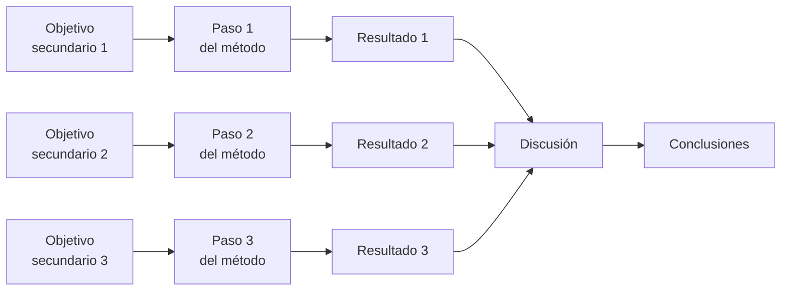

# Estructura de la memoria

Hay un esquema que sirve para casi cualquier trabajo fin de titulación, sea de desarrollo, experimental o de revisión. Es el mismo que usan los artículos científicos, y tiene una ventaja enorme: **cada capítulo responde a una pregunta** y el lector sabe dónde encontrar cada cosa.

## El esquema universal

| Capítulo | Pregunta que responde |
|---|---|
| 1. **Introducción** | ¿Cuál es el problema y por qué importa? |
| 2. **Trabajos relacionados** | ¿Qué se ha hecho ya y qué falta? |
| 3. **Objetivos** | ¿Qué voy a hacer exactamente? |
| 4. **Materiales y métodos** | ¿Con qué y cómo lo he hecho? |
| 5. **Resultados** | ¿Qué he obtenido? |
| 6. **Discusión** | ¿Qué significan mis resultados frente a lo que ya se sabía? |
| 7. **Conclusiones** | ¿He cumplido los objetivos? ¿Qué queda por hacer? |
| **Referencias** | ¿En qué me he apoyado? |

Antes de los capítulos van la **portada**, el **resumen** y el ***abstract*** con palabras clave y los **índices**. Al final, los **anexos** si los necesitas. La normativa de tu universidad puede pedir algún capítulo más (por ejemplo, impacto, presupuesto o aspectos éticos y legales). Añádelos, pero mantén este esqueleto.

## El hilo conductor

!!! clave "Un resultado por cada paso del método"
    Para que la memoria sea sencilla de escribir y de leer, cada **objetivo secundario** se convierte en un **paso del método**, que produce **un resultado**, que se **discute** y que lleva a **una conclusión**.

Un ejemplo:

| Objetivo secundario | Paso del método | Resultado |
|---|---|---|
| OS1. Seleccionar y preparar un conjunto de datos público de ECG | 4.1 Selección y preprocesado de datos | 5.1 Descripción del conjunto final (n.º de registros, clases, calidad) |
| OS2. Entrenar dos modelos de clasificación | 4.2 Diseño y entrenamiento de los modelos | 5.2 Curvas de aprendizaje y configuración final |
| OS3. Comparar su rendimiento | 4.3 Protocolo de evaluación y métricas | 5.3 Tabla comparativa de métricas con intervalos de confianza |

Si al terminar algún resultado no corresponde a ningún objetivo, o algún objetivo no tiene resultado, hay un problema de coherencia. Esta tabla te sirve de comprobación.

## Capítulo a capítulo

### Resumen y abstract

Se escribe **al final**. Entre 250 y 300 palabras (o lo que pida tu universidad), con esta estructura: contexto (1–2 frases), objetivo, métodos, resultados principales **con cifras** y conclusión. Añade 4–6 palabras clave. Mucha gente solo leerá esto.

### 1. Introducción

Va de lo general a lo particular: el **contexto**, el **problema** concreto y la **motivación** (por qué merece la pena resolverlo, con datos y citas). Puede terminar con un párrafo que explique la estructura del documento. Escríbela al final, cuando ya sabes qué has contado.

### 2. Trabajos relacionados

El estado del arte, hecho con método (ver [Estado del arte](estado-del-arte.md)). Organizado por temas, con una tabla comparativa, y terminando con **el hueco que tu trabajo va a cubrir**.

### 3. Objetivos { #objetivos }

- **Objetivo principal (o primario):** uno, en una frase, con verbo comprobable.
- **Objetivos secundarios:** 2–4, que juntos permiten alcanzar el principal. Cada uno será un paso del método.

Si tu trabajo plantea una **pregunta de investigación** o una **hipótesis**, va aquí también. Algunas universidades prefieren los objetivos dentro de la introducción: sigue tu normativa.

### 4. Materiales y métodos

- **Materiales:** las herramientas (datos, participantes, *software*, *hardware*, instrumentos).
- **Métodos:** los pasos que diste, en orden, y **basados en qué metodología**.

Todo lo necesario para que otra persona lo repita. Más detalle en [Metodología y desarrollo](metodologia.md).

### 5. Resultados

- **Un apartado por paso del método**, en el mismo orden.
- Solo **hechos**: cifras, tablas, figuras. Sin interpretar todavía.
- Cada figura y tabla se **menciona en el texto** y se explica qué muestra.
- Incluye también lo que no salió como esperabas. Un resultado negativo bien contado es un resultado.

### 6. Discusión

Aquí sí interpretas. Para cada resultado importante:

- **¿Qué significa?**
- **¿Cómo se compara con el estado del arte?** ¿Coincide con lo que se ha publicado o lo contradice? ¿Por qué puede ser? Aquí vuelves a citar los trabajos relacionados.
- **Limitaciones:** qué no se puede afirmar con tus datos o tu diseño. Reconocerlas es una señal de madurez, no de debilidad.
- **Implicaciones:** para quién es útil y en qué contexto.

### 7. Conclusiones

- **Una conclusión por objetivo**, diciendo si se ha cumplido y cómo.
- **Líneas futuras**: qué harías con más tiempo o recursos.
- **Ni datos nuevos ni citas.** Las conclusiones se apoyan en lo que ya has contado.

### Referencias

Generadas automáticamente con un [gestor de referencias](bibliografia.md), en un único estilo.

### Anexos

Lo que es útil pero interrumpiría la lectura: código extenso, cuestionarios completos, tablas largas o la lista de comprobación de la guía de publicación que hayas seguido.

## Proporciones orientativas

Cada trabajo es distinto, pero si un capítulo se sale mucho de estas proporciones, revisa por qué:

| Capítulo | Peso aproximado |
|---|---|
| Introducción | 10 % |
| Trabajos relacionados | 20 % |
| Objetivos | 2–3 % |
| Materiales y métodos | 20–25 % |
| Resultados | 20–25 % |
| Discusión | 10–15 % |
| Conclusiones | 3–5 % |

Las [plantillas en Word y LaTeX](plantillas.md) ya traen esta estructura con indicaciones dentro de cada capítulo.
