<section class="hero">
  

    
Guía para TFG · TFM · TFT · TFE

    <h1>Cómo hacer un buen trabajo fin de titulación</h1>
    
Esta guía reúne las lecciones aprendidas tras años dirigiendo trabajos fin de grado (TFG), fin de máster (TFM), fin de título (TFT) y fin de estudios (TFE): lo que funciona, los errores que se repiten y cómo evitarlos.

    

      <a class="boton boton--hielo" href="tema/">Empieza por aquí</a>
      <a class="boton boton--borde" href="plantillas/">Descarga las plantillas</a>
      <a class="boton boton--borde" href="checklist/">Abre la checklist</a>
    

  

  

    
  

</section>

<section class="bloque">
  
El camino, paso a paso

  <h2>Cinco etapas, en este orden</h2>
  <ol class="ruta">
    <li><a href="tema/">01<strong>Acota el tema</strong>Un objetivo principal, concreto y viable.</a></li>
    <li><a href="estado-del-arte/">02<strong>Revisa la literatura</strong>Con método: tipo de revisión, marco y buscadores académicos.</a></li>
    <li><a href="metodologia/">03<strong>Diseña el método</strong>Materiales, pasos y la metodología en la que te apoyas.</a></li>
    <li><a href="estructura/">04<strong>Escribe la memoria</strong>El esquema universal: un resultado por paso del método.</a></li>
    <li><a href="defensa/">05<strong>Defiéndelo</strong>Una presentación clara y preguntas preparadas.</a></li>
  </ol>
</section>

<section class="bloque">
  
Lo que más repito

  <h2>Tres ideas que lo cambian todo</h2>
  

    <a class="idea" href="tema/">
      1
      <h3>Un objetivo concreto vale más que cinco ambiciosos</h3>
      
El error más frecuente es querer hacer demasiado. Elige un objetivo principal que puedas cumplir de verdad con tu tiempo, tus datos y tus herramientas.

    </a>
    <a class="idea" href="estado-del-arte/">
      2
      <h3>El estado del arte se hace con método</h3>
      
Revisión sistemática, de alcance o narrativa; marcos como JBI o PRISMA; bases como Web of Science, Scopus o PubMed. No vale buscar en Google.

    </a>
    <a class="idea" href="estructura/">
      3
      <h3>Hay un esquema que funciona casi siempre</h3>
      
Y una regla sencilla para que todo encaje: cada objetivo secundario es un paso del método, y cada paso produce un resultado.

    </a>
  

</section>

<section class="bloque bloque--hielo">
  
El esquema universal

  <h2>La estructura de tu memoria</h2>
  

    IntroducciónTrabajos relacionadosObjetivosMateriales y métodosResultadosDiscusiónConclusionesReferencias
  

  
<a href="estructura/">Qué va en cada capítulo →</a>

</section>

<section class="bloque">
  
Recursos

  <h2>Para usar desde el primer día</h2>
  

    <a class="recurso" href="plantillas/"><strong>Plantillas de la memoria</strong>Word y LaTeX/Overleaf, con la estructura e indicaciones en cada capítulo.</a>
    <a class="recurso" href="plantillas/#para-el-proceso"><strong>Ficha de propuesta</strong>Para traer a la primera tutoría con el objetivo ya pensado.</a>
    <a class="recurso" href="plantillas/#para-el-proceso"><strong>Tabla de revisión de literatura</strong>Registro de búsquedas y extracción de estudios, en Excel.</a>
    <a class="recurso" href="checklist/"><strong>Checklist</strong>Antes de escribir, antes de entregar y antes de defender. Guarda tu progreso.</a>
  

</section>

<section class="bloque autora">
  
  

    
Quién escribe esta guía

    
<strong>Beatriz Merino-Barbancho</strong>, ingeniera biomédica y doctora, investigadora y gestora de proyectos en salud digital e inteligencia artificial. Ha dirigido trabajos fin de titulación en varias universidades.

    
Ingeniería, datos y personas para una salud más conectada.

  

</section>

!!! note "Normativa de tu universidad"
    Cada universidad tiene su normativa: extensión, formato de portada, plazos o duración de la defensa. Esta guía trata **cómo hacer un buen trabajo**. Para los requisitos formales, manda siempre la normativa de tu centro.
